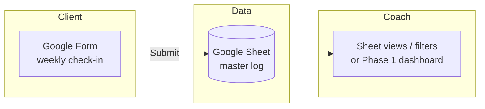

# Personal Wellness Intelligence

**Coach–client wellness platform (bodybuilding focus)** with simple check-ins, progress visibility, and—later—AI-assisted communication. Built for people who want coaching support without it feeling like homework.

> **Status:** Planning / Phase 0 (Google Forms + Sheets MVP)  
> **Portfolio:** [Juan Cortes — Matrix Portfolio](https://github.com/NOTJUANCORTES/juan-cortes-matrix-portfolio) *(update when live site URL is set)*

---

## Vision

Personal Wellness Intelligence helps **coaches** run consistent, low-friction programs and **clients** stay accountable through structured self-reporting—not another heavy app. The north star is **operational wellness analytics**: adherence, sleep–mood–training patterns, and coach responsiveness—not clinical diagnosis.

**Design principles**

- **Low friction:** Google Forms + Sheets for Phase 0 so novices can ship questionnaires in an afternoon.
- **Simple UX:** Short weekly flows; dashboards that answer “Am I on track?” in one glance.
- **Privacy by default:** Health-adjacent data (photos, mood, sleep); consent and role-based access from day one.
- **Responsible AI (later):** RAG/evals and guardrails after human workflows are proven—not before.

---

## User personas

| Persona | Goals | Pain today |
|--------|--------|------------|
| **Coach (e.g., online bodybuilding coach)** | See who’s slipping, respond quickly, adjust splits | DMs scattered across apps; no trend view |
| **Client (busy professional / student)** | Log check-ins in &lt;5 min; see progress photos over time | Tracking feels like a second job |
| **Portfolio reviewer (health/hospital analyst hiring)** | See problem → data → approach → insight → decision | Generic “AI dashboard” with no measurement story |

---

## Phase 0 workflow: Google Forms → Sheets



**Suggested Form fields (MVP)**

- Date, client ID (or email hash)
- Sleep (hours + 1–5 quality)
- Mood (1–5)
- Training: days completed vs planned; split name (e.g., PPL)
- Optional: weight, steps, notes
- Consent checkbox (photos / data use)

**Sheet tabs**

- `responses` — raw Form linked sheet  
- `clients` — roster, coach assignment, start date  
- `config` — split templates, KPI targets  

---

## Roadmap

- [ ] **Phase 0 — Forms + Sheets** — Launch weekly check-in Form; coach reads Sheet (filters, charts in Sheets).
- [ ] **Phase 1 — Read-only dashboards** — Lightweight web app or Looker Studio; coach + client views; no write path yet.
- [ ] **Phase 2 — Check-ins + progress photos** — Secure upload (Drive folder per client or app storage); timeline UI; adherence KPIs.
- [ ] **Phase 3 — AI chat with guardrails** — Coach/client messaging assist; scoped context; human-in-the-loop; evals before scale.

See [docs/MVP.md](./docs/MVP.md) and [docs/ARCHITECTURE.md](./docs/ARCHITECTURE.md) for detail.

---

## Portfolio narrative template (health-adjacent analytics)

Use this structure on your site and in interviews—not as a clinical EHR story, but as **operational measurement + decision support**.

| Section | What to write |
|--------|----------------|
| **Problem** | Coaches lose signal in chat; clients churn when check-ins feel heavy. How do we measure **adherence and wellbeing proxies** without overclaiming clinical validity? |
| **Data** | Self-reported sleep, mood, training split completion; timestamps for coach replies; optional progress photos (with consent). Source: Forms → Sheets → (later) API. |
| **Approach** | Define KPIs (adherence rate, sleep–mood correlation, response time); document **signal vs noise** and **surveillance bias** (only engaged clients report). Note FHIR as *future* interoperability if scope expands to care settings—not required for MVP. |
| **Insight** | Example: “Clients with &lt;6h sleep avg show lower split completion; early coach ping within 24h correlates with re-engagement” (hypothesis to test with n≥?). |
| **Decision** | Product: keep Forms for Phase 0; invest in dashboard when coach roster &gt;5; defer diagnostic AI; add RAG only with eval set and escalation paths. |

**Example KPIs (operational, not diagnostic)**

- Weekly check-in **adherence** (% submitted / enrolled)
- **Sleep–mood–training** cross-tab or simple correlation (with missing-data notes)
- Coach **median response time** (manual log or timestamp column)
- **Photo cadence** (every N weeks)—consistency, not body composition “diagnosis”

---

## Repository layout

```
personal-wellness-intelligence/
├── apps/web/          # Future lightweight dashboard (Phase 1+)
├── docs/              # MVP, architecture, privacy notes
├── scripts/           # Sheets export, seed data (no secrets)
└── README.md
```

---

## Getting started (Phase 0)

1. Duplicate a [weekly check-in Google Form](https://forms.google.com) template (create your own—do not commit Form IDs if private).
2. Link responses to a Google Sheet; add `clients` tab manually.
3. Share Sheet with coach account only; clients never need Sheet access.
4. When ready for Phase 1, see [docs/ARCHITECTURE.md](./docs/ARCHITECTURE.md) for stack options.

---

## License

TBD (recommend MIT for portfolio code, separate policy for client data in production).

---

## Author

**Juan Cortes** — UCLA MASDS; health/hospital analyst track.  
GitHub: [@NOTJUANCORTES](https://github.com/NOTJUANCORTES)
